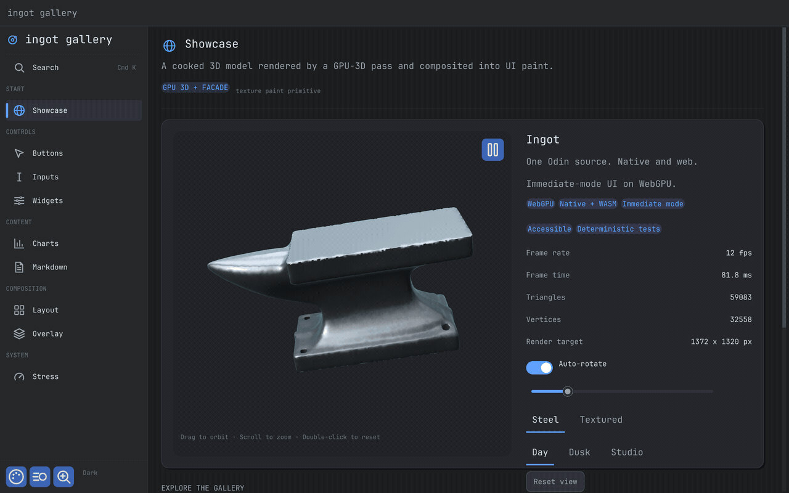

<p align="center">
  
</p>

<p align="center">
  <strong>The Odin app framework for polished native and web desktop tools—without Electron.</strong>
</p>

<p align="center">
  <a href="LICENSE"></a>
  <a href="CHANGELOG.md"></a>
</p>

<p align="center">
  <a href="https://openalloy.ai/ingot">Live demo and benchmarks</a>
</p>

<p align="center">
  <a href="https://openalloy.ai/demos/ingot-gallery/"></a>
</p>

<p align="center">
  <a href="https://openalloy.ai/demos/ingot-gallery/">Open the interactive WebAssembly/WebGPU gallery</a>
</p>

Ingot is a self-contained immediate-mode framework built on Odin's bundled
`vendor:wgpu`. One renderer targets macOS/Metal, Windows/D3D12, Linux/Vulkan,
and browser WASM/WebGPU. GLFW remains the default native host backend; install
SDL3 and pass `-define:INGOT_GFX_SDL3=true` to select the optional SDL3 host.

- Native and web builds from one source
- Immediate-mode UI for desktop tools
- Bounded named commands and contextual keyboard shortcuts
- Bounded raw mouse, touch, and pen events with caller-owned behavior
- Batched 2D graphics, input, audio, networking, accessibility, and terminals
- Event-driven rendering with near-zero idle work
- Deterministic, bounded test harnesses

> [!IMPORTANT]
> `0.4.1` is the latest published source tag. Pin it and read the
> [release ledger](docs/releases/0.4.1.md). Upgrading from 0.3.3 requires the
> [migration guide](docs/migration-0.4.0.md). Validate every platform you ship;
> the committed Windows libvterm archive still lacks the REP fix.

## The experiment

Ingot explores whether deterministic simulation testing can shape an application
framework from the start. Explicit state, bounded work, and compile-gated seams
let seeded harnesses exercise production code without requiring a window, GPU,
network, shell, or assistive technology. This is an engineering experiment—not
a claim of correctness or production readiness. See [Testing](docs/testing.md).

## API paths

Use `ingot:fit` for applications and `ingot:gfx` for graphics-first programs.
`ingot:ui` and managed `ingot:ui_gfx` hosts are advanced application layers.
Optional networking, terminal, engine, and accessibility packages compose
through explicit imports; there is no umbrella runtime profile.

## Quick start

```sh
git submodule add https://github.com/Nic-vdwalt/ingot.git libs/ingot
git -C libs/ingot checkout 0.4.1
odin build src -collection:ingot=libs/ingot
```

Use the Odin revision recorded in [`ODIN_VERSION`](ODIN_VERSION). Tag `0.4.1`
resolves to `6e87b46bff2f268b0685f9fcd17f5e4837865b49`.
On Windows, add `-linker:msvc` (or `-linker:lld`) to graphics-linked build/run
commands, including the examples below:

```sh
odin build src -collection:ingot=libs/ingot -linker:msvc
```

This is a source pin, not binary distribution or platform-validation approval.

The recommended
entry point for UI applications is `ingot:fit`:

```odin
package main

import "core:fmt"
import fit "ingot:fit"

App_State :: struct {
	button_clicks: u64,
}

app: fit.App
state: App_State

main :: proc() {
	_ = fit.run(&app, {width = 960, height = 640, title = "Ingot app"}, Draw, &state)
}

Continue :: proc(user_data: rawptr) {
	assert(user_data != nil)
	state := cast(^App_State)user_data
	state.button_clicks += 1
}

Draw :: proc(builder: ^fit.Builder, user_data: rawptr) {
	assert(builder != nil && user_data != nil)
	state := cast(^App_State)user_data
	root := fit.center(builder, {gap = .SM, padding = .LG})
	fit.label(root, "Hello from Ingot")
	fit.label(root, fmt.tprintf("Button clicks: %d", state.button_clicks))
	fit.button(root, "continue", "Continue", fit.action(Continue, state))
}
```

Read the [Fit guide](docs/fit-guide.md) for timing, caller-owned state, reusable
components, typed commands, and headless tests without introducing another API.

See the [layout guide](docs/layout.md) for responsive Flow, track Grid, sizing,
and placement options. Larger applications can optionally converge buttons,
menus, shortcuts, and integration completions on a caller-owned bounded typed
queue with `typed_commands_begin(&queue, builder)`, the recommended operation
path. Use `button_result` for owned polling. The Action example above is an
advanced compatibility path: its context must survive rendering and dispatch. See
[Commands and contextual shortcuts](docs/commands.md) and
`examples/typed_commands`.

Advanced applications that need direct control over UI state and rendering can
use the lower-level `ui` and `ui_gfx` packages. These expose more lifecycle and
layout details than `fit`, so the application assumes more integration
responsibility:

```odin
package main

import "core:fmt"
import ui "ingot:ui"
import "ingot:ui_gfx"

App_State :: struct {
	button_clicks: u64,
}

app: ui_gfx.App
state: App_State

main :: proc() {
	_ = ui_gfx.app_run(
		&app,
		{
			width = 960,
			height = 640,
			title = "Ingot app",
			session = {semantics_enabled = true},
		},
		{ui = Draw},
		&state,
	)
}

Draw :: proc(app: ^ui_gfx.App, form: ^ui.Ui, user_data: rawptr) {
	assert(app != nil && form != nil && user_data != nil)
	state := cast(^App_State)user_data
	ui.padding(form, .LG)
	ui.label(form, "Hello from Ingot", ui.ui_frame_metrics(form.frame).FONT_SIZE_TITLE)
	ui.label(form, fmt.tprintf("Button clicks: %d", state.button_clicks))
	if ui.button(form, "continue", "Continue") {
		state.button_clicks += 1
	}
}
```

Run an example:

```sh
odin run examples/gallery -collection:ingot=.
```

## Explore

- [Widget gallery](examples/gallery/)
- [Builder controls example](examples/builder_controls/)
- [API map](https://openalloy.ai/demos/ingot-api-map/)
- [Why immediate mode](docs/immediate-mode.md)
- [Choosing Ingot](docs/comparison.md)
- [Examples](examples/)
- [Widget benchmarks](benchmarks/widgets/README.md)
- [End-to-end performance evidence](docs/performance.md)
- [GUI parity target](docs/gui-parity.md)

## Documentation

- [API layers](docs/api-layers.md)
- [Commands and shortcuts](docs/commands.md)
- [Widget reference](docs/widgets.md)
- [Choosing a widget](docs/widget-choice.md)
- [Dependencies and package composition](docs/dependencies.md)
- [Performance evidence](docs/performance.md)
- [Pointer input](docs/pointer-input.md)
- [Borrowed UI ideas](docs/borrowed-ui-ideas.md)
- [Text and asset dependency policy](docs/text-asset-dependency-policy.md)
- [Testing](docs/testing.md)
- [Compatibility](docs/compatibility.md)
- [Rendering](docs/rendering.md)
- [Networking](docs/networking.md)
- [Migrating from raylib](docs/raylib-migration.md)
- [Production readiness](docs/production-readiness.md)

See [Contributing](CONTRIBUTING.md), [Security](SECURITY.md), and the
[Changelog](CHANGELOG.md). Licensed under [Apache 2.0](LICENSE); bundled works
are listed in [Third-party notices](THIRD_PARTY_NOTICES.md).
